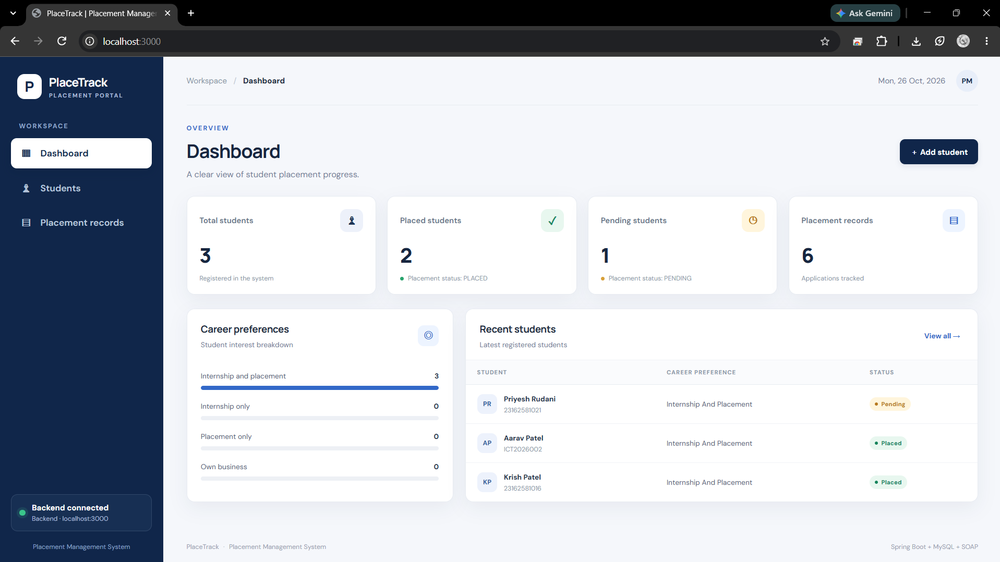
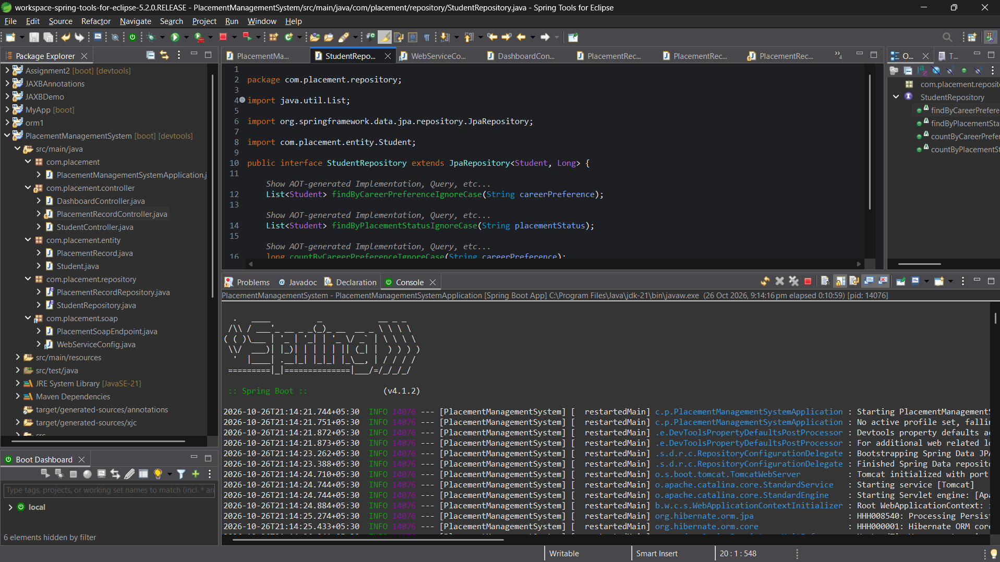
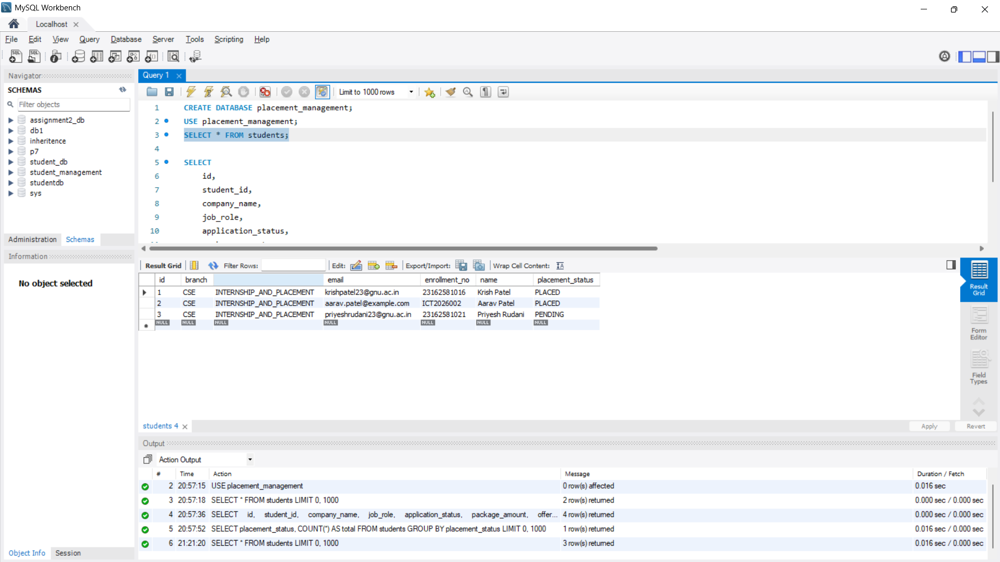
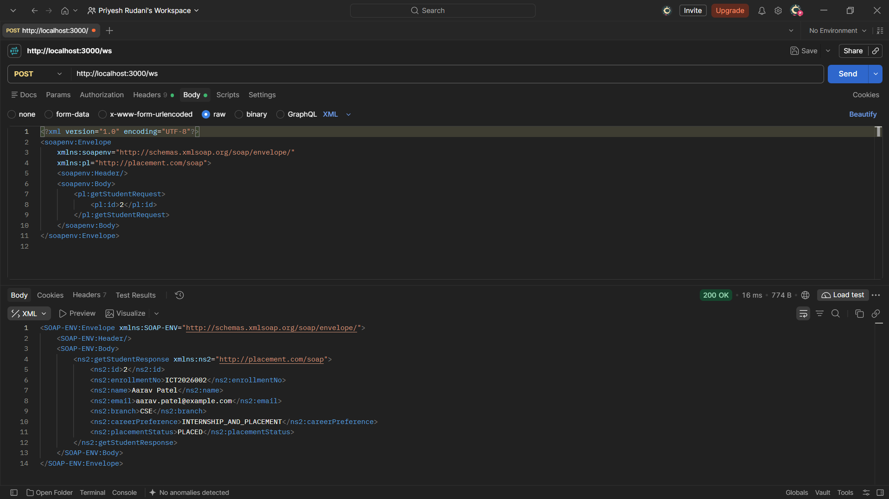

<div align="center">

# PlaceTrack — Placement Management System

**Student placement tracking with Spring Boot, MySQL, REST APIs, and SOAP Web Services.**

[](https://www.oracle.com/java/)
[](https://spring.io/projects/spring-boot)
[](https://www.mysql.com/)
[](https://maven.apache.org/)

</div>

---

## Overview

PlaceTrack is a web-based Placement Management System for maintaining student information, recording placement applications, and monitoring placement progress. It combines a browser-based interface with a Spring Boot backend, MySQL persistence, REST endpoints, and a SOAP service for student retrieval.

## Screenshots

### Dashboard


### Spring Tools for Eclipse — project and application


### MySQL database records


### SOAP API test in Postman


## Features

- **Student management:** create, list, retrieve, update, delete, and filter students.
- **Placement records:** create and view application records, search by student, company, or status, and delete records.
- **Dashboard statistics:** summarize students by placement status and career preference.
- **Offer status automation:** saving a placement record with status `OFFERED` updates the associated student's status to `PLACED`.
- **REST API:** HTTP endpoints for student, placement-record, and dashboard operations.
- **SOAP Web Service:** retrieve a student by ID using XML.
- **MySQL persistence:** Spring Data JPA/Hibernate.
- **Input validation:** required student fields and email format.

## Technology Stack

| Area | Technology |
|---|---|
| Language | Java 21 |
| Backend | Spring Boot 4.1.2 |
| REST API | Spring Web MVC |
| Persistence | Spring Data JPA / Hibernate |
| Database | MySQL |
| Validation | Jakarta Bean Validation |
| SOAP | Spring Web Services, XSD, JAXB-generated classes, WSDL |
| Build | Maven |
| IDE | Spring Tools for Eclipse |
| Frontend | HTML, CSS, JavaScript |
| API testing | Postman |

## Architecture

```text
Browser (PlaceTrack UI)
        | HTTP / JSON
        v
Spring Boot REST Controllers
  |          |             |
Student   Placement     Dashboard
Controller Controller   Controller
  |          |
  +---- Spring Data JPA Repositories ----+
                                         |
                                      MySQL DB

SOAP Client -- XML --> /ws/* --> PlacementSoapEndpoint
                                      |
                               StudentRepository
```

## Project Structure

```text
PlacementManagementSystem/
├── .mvn/wrapper/
├── pom.xml
├── mvnw
├── mvnw.cmd
└── src/
    ├── main/
    │   ├── java/com/placement/
    │   │   ├── PlacementManagementSystemApplication.java
    │   │   ├── controller/
    │   │   │   ├── DashboardController.java
    │   │   │   ├── PlacementRecordController.java
    │   │   │   └── StudentController.java
    │   │   ├── entity/
    │   │   │   ├── PlacementRecord.java
    │   │   │   └── Student.java
    │   │   ├── repository/
    │   │   │   ├── PlacementRecordRepository.java
    │   │   │   └── StudentRepository.java
    │   │   └── soap/
    │   │       ├── PlacementSoapEndpoint.java
    │   │       └── WebServiceConfig.java
    │   └── resources/
    │       ├── application.properties
    │       ├── placement.xsd
    │       └── static/
    │           ├── index.html
    │           ├── css/style.css
    │           └── js/app.js
    └── test/
```

## Setup and Run

### Prerequisites
- JDK 21
- MySQL Server
- Maven (or use the included Maven wrapper)

### 1. Create the database

```sql
CREATE DATABASE placement_management;
```

### 2. Configure credentials

The committed `application.properties` reads the database password from an environment variable. Set credentials before starting the application.

**PowerShell:**

```powershell
$env:DB_USERNAME = "root"
$env:DB_PASSWORD = Read-Host "Enter your MySQL password"
```

Do not commit real credentials. The username defaults to `root` if `DB_USERNAME` is not set.

### 3. Start the application

```powershell
.\mvnw.cmd spring-boot:run
```

Alternatively, import the project into Spring Tools for Eclipse and run `PlacementManagementSystemApplication` as a Spring Boot application.

### 4. Open the application

- **Frontend:** http://localhost:3000/
- **SOAP WSDL:** http://localhost:3000/ws/placement.wsdl
- **SOAP endpoint:** http://localhost:3000/ws

## REST API Reference

Base URL: `http://localhost:3000`

### Students

| Method | Endpoint | Description |
|---|---|---|
| `POST` | `/api/students` | Create a student |
| `GET` | `/api/students` | List students |
| `GET` | `/api/students/{id}` | Get a student by ID |
| `PUT` | `/api/students/{id}` | Update a student |
| `DELETE` | `/api/students/{id}` | Delete a student |
| `GET` | `/api/students/preference/{preference}` | Filter by career preference |
| `GET` | `/api/students/status/{status}` | Filter by placement status |

### Dashboard

| Method | Endpoint | Description |
|---|---|---|
| `GET` | `/api/dashboard/statistics` | Get dashboard statistics |

### Placement records

| Method | Endpoint | Description |
|---|---|---|
| `POST` | `/api/placement-records` | Create a placement record |
| `GET` | `/api/placement-records` | List placement records |
| `GET` | `/api/placement-records/{id}` | Get a placement record |
| `GET` | `/api/placement-records/student/{studentId}` | Filter by student |
| `GET` | `/api/placement-records/company/{companyName}` | Filter by company |
| `GET` | `/api/placement-records/status/{status}` | Filter by application status |
| `DELETE` | `/api/placement-records/{id}` | Delete a placement record |

## SOAP Service

The SOAP contract is defined in `src/main/resources/placement.xsd`. `getStudentRequest` accepts a student ID and returns student details in `getStudentResponse`.

Example request body:

```xml
<soapenv:Envelope xmlns:soapenv="http://schemas.xmlsoap.org/soap/envelope/"
                  xmlns:pl="http://placement.com/soap">
    <soapenv:Header/>
    <soapenv:Body>
        <pl:getStudentRequest>
            <pl:id>2</pl:id>
        </pl:getStudentRequest>
    </soapenv:Body>
</soapenv:Envelope>
```

Send as `POST http://localhost:3000/ws` with `Content-Type: text/xml`. A successful request returns a SOAP XML response.

## Database Model

- `Student` maps to the `students` table.
- `PlacementRecord` maps to `placement_records`.
- Each placement record references a student using a many-to-one relationship and the `student_id` foreign-key column.
- Hibernate is configured with `spring.jpa.hibernate.ddl-auto=update`.

## Testing Evidence

The screenshots document the dashboard, project running in the IDE, MySQL records, and a successful SOAP request returning `200 OK`. REST and placement functionality were tested during development.

## Security Notes

- Never commit database passwords, API tokens, or other secrets.
- The repository configuration uses `${DB_PASSWORD}` to keep the database password outside source control.
- Before deploying publicly, review authentication, authorization, database access, and secret management.

## Future Improvements

- Add authentication and role-based access.
- Add pagination and advanced filtering.
- Add centralized exception handling and consistent error responses.
- Add automated integration tests for REST, persistence, and SOAP fault cases.
- Deploy to a cloud hosting environment.

---

<div align="center">

**PlaceTrack — Placement Management System**

Built with Java and Spring Boot.

</div>
